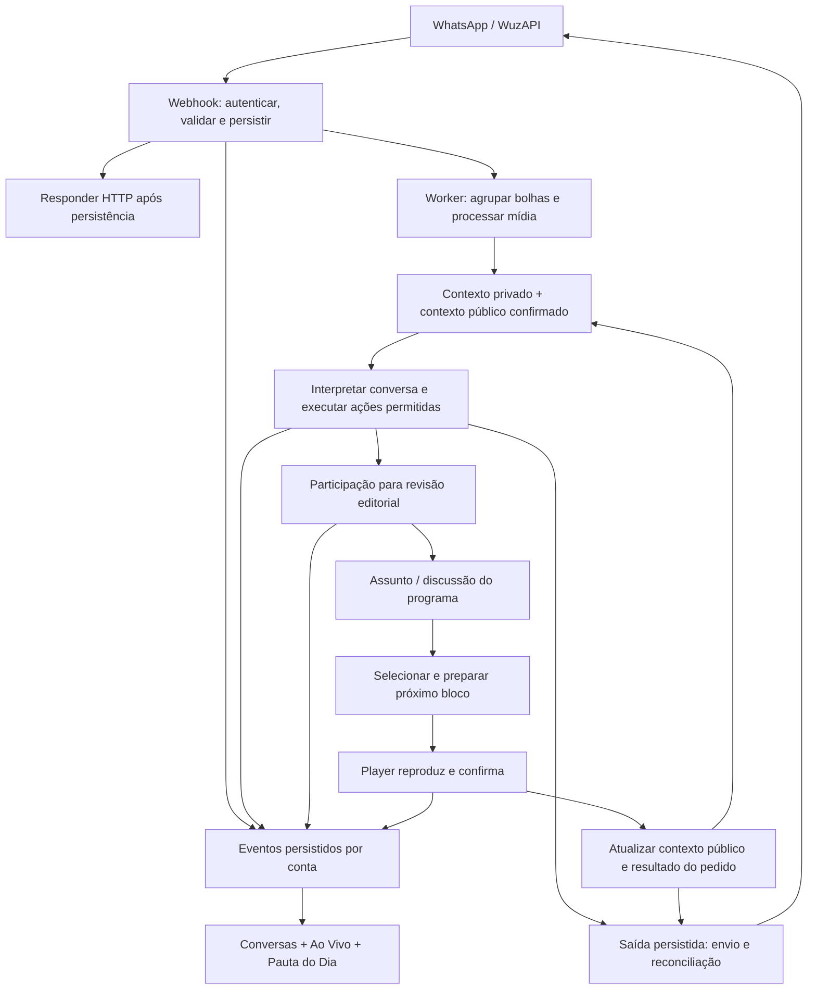

# Plano de evolução: WhatsApp, conversas, contexto e assuntos ao vivo

Análise do código local em 11/11/2026. Este documento propõe implementação; não ativa contas, altera o atendimento existente nem envia mensagens. Considera também as alterações já presentes na árvore de trabalho, sem pressupor que estejam em produção.

Atualização de 12/11/2026: execução local, operação, testes e limites de validação registrados em [whatsapp-operacao.md](whatsapp-operacao.md).

## 1. Direção recomendada

Construir uma central de conversas que compartilhe com o Ao Vivo o estado dos pedidos e o contexto efetivamente reproduzido. O objetivo é fechar o ciclo:

**O locutor faz uma pergunta → o ouvinte responde → o atendimento entende a referência → a equipe revisa a participação → o programa a utiliza → a reprodução confirma o resultado → a conversa recebe esse resultado.**

Já existem componentes suficientes para evoluir na stack atual: FastAPI, PostgreSQL, Redis, Next.js, WuzAPI e motor de assuntos. O trabalho principal é unificar o estado, tornar o processamento recuperável e acrescentar os vínculos entre mensagens, participações, assuntos e blocos reproduzidos.

## 2. O que existe e pode ser aproveitado

| Capacidade | Implementação atual | Aproveitamento |
| --- | --- | --- |
| Conexão e autenticação | `backend/app/whatsapp/session_manager.py`, `backend/app/onboarding/router.py` | QR Code, identificação por conta, HMAC, mídia em base64 e recuperação de token órfão. |
| Entrada de mensagens | `backend/app/whatsapp/webhook.py`, `inbox.py` | Texto, transcrição de áudio, descrição de imagem, persistência das bolhas e agrupamento após seis segundos de silêncio no fluxo novo. |
| Atendimento contextual | `backend/app/whatsapp/atendimento.py` | Histórico curto, esclarecimento de pedidos incompletos, correção, cancelamento e pausa para humano. |
| Operação editorial | `backend/app/whatsapp/gestao.py`, `models/fila_ao_vivo.py` | Texto privado separado do texto aprovado, revisão, transferência, estados e histórico de ações. |
| Confirmação de participação | `gestao.py`, `frontend-painel/lib/participacoes.ts`, `hooks/useLiveEngine.ts` | Seleção com token e callback idempotente de reprodução para os pedidos do fluxo novo. |
| Histórico de conversas | `backend/app/metrics/router.py`, `frontend-painel/app/conversas/page.tsx` | Lista, mensagens paginadas, avatar e exportação CSV. |
| Motor editorial | `backend/app/topics/` | Derivação de ganchos, associação a programas, validade, score, alternância de eixos e prevenção de repetição. |
| Contexto de emissão | `backend/app/live/contexto.py`, `prompt_emissao.py`, `topics/pauta_conversa.py` | Contexto do bloco, notícias, músicas, recorrência de ouvintes e retomadas entre blocos. |
| Custos e capacidade | `backend/app/billing/contexto_ia.py`, `guardrails/provedores.py` | Reutilizar atribuição de consumo e controle dos provedores no processamento em background; preservar o contexto da conta ao sair da requisição HTTP. |

O atendimento novo é opcional por conta (`atendimento_ouvinte_ativo`, padrão `false`), e o envio automático depende também de `resposta_automatica_whatsapp` no radialista. A documentação operacional existente está em [atendimento-ouvintes.md](atendimento-ouvintes.md).

## 3. Lacunas encontradas no código

### P0 — Confiabilidade antes de ampliar o fluxo

1. **O webhook ainda executa o atendimento.** `webhook.py` faz STT/visão antes de chamar a inbox; `inbox.receber()` aguarda seis segundos e depois executa o processamento em thread. O caminho legado também espera e executa chamadas síncronas na rota assíncrona. Isso aumenta o tempo de resposta e a exposição a timeout/reentrega. Mover apenas a espera para uma tarefa em memória não resolve recuperação após reinício.
2. **A inbox é persistente, mas não tem consumidor autônomo de recuperação.** No código inspecionado, o processamento é disparado pela própria requisição. Uma bolha pode ficar pendente se o processo cair depois do commit e nenhuma nova mensagem/reentrega chegar. A falha antes de commit já tem teste de retry; falta recuperação independente do provedor.
3. **Deduplicação ocorre tarde para mídia.** A consulta inicial procura `InteractionLog`; bolhas ainda em processamento estão em `MensagemOuvinte`. Reentregas concorrentes podem voltar a transcrever/descrever antes da deduplicação da inbox. O caminho legado também mantém deduplicação e buffer diferentes do novo.
4. **Envio não retorna a identidade da mensagem.** `sender.enviar_mensagem()` valida o HTTP e retorna `None`. O reconhecimento de eco `FromMe` procura qualquer resposta histórica de texto igual para aquele telefone. Uma mensagem manual idêntica pode ser confundida com eco, e não há vínculo persistido com o ID de saída do provedor.
5. **Há um limitador de 60 webhooks/minuto por IP antes de identificar a conta.** Se várias rádios chegam pelo mesmo WuzAPI/IP, compartilham esse teto, incluindo reentregas e ecos. É um risco de gargalo a medir, não uma afirmação de perda já observada.
6. **O Redis do deploy usa `allkeys-lru` e é compartilhado com travas.** Sob pressão de memória, uma trava pode ser removida antes do TTL. Garantias de exclusão e recuperação devem ficar no PostgreSQL ou em infraestrutura de coordenação com política apropriada; cache pode continuar descartável.

### P1 — Conversa e contexto fragmentados

7. **A tela Conversas é um histórico, sem atualização automática das mensagens.** Carrega ao abrir/paginar/selecionar. O painel de interações consulta a cada quatro segundos; o de atendimento consulta seis endpoints a cada quinze segundos. Não foi encontrado canal de eventos para essas telas.
8. **A resposta automática não é renderizada diretamente na thread principal.** A API entrega `resposta`, mas `conversas/page.tsx` renderiza `mensagem_usuario`; uma resposta só aparece como bolha da rádio se houver log de eco `FromMe`. O botão de carregar antigas substitui o array, em vez de acrescentar mensagens ao histórico visível. Também falta proteção explícita contra respostas HTTP fora de ordem ao trocar de conversa.
9. **As ações da conversa ficam no Ao Vivo.** Assumir/devolver o atendimento e revisar participações estão em `AtendimentoOuvintesPanel`; a tela Conversas não oferece envio manual. A API de conversas operacionais retorna no máximo cinquenta itens, sem paginação.
10. **A memória do agente é curta e reinicia por ocorrência.** `ConversaOuvinte.historico` guarda até dez entradas; a interpretação usa oito. A memória é limpa após 24 horas de inatividade e na troca de ocorrência do programa. Não há resumo estruturado persistente, vínculo de resposta citada nem referência à pergunta feita no ar.
11. **O bot recebe configuração do programa, não um retrato do que o player reproduziu.** `_atender()` usa `montar_system_prompt()` e o histórico privado; não recebe assunto ativo, bloco em reprodução, última pergunta ou últimas falas confirmadas. “Concordo com aquilo” não tem uma referência editorial confiável.
12. **A grade é tratada como indicação de quem está no ar.** `_radialista_no_ar()` e `/live/no-ar` usam horários. Isso não prova reprodução no navegador. Além disso, `_registrar_fala_no_ar()` registra assunto usado e retomadas após geração/TTS, antes de confirmação geral do player. Os pedidos novos já têm confirmação própria; o restante dos blocos não tem o mesmo contrato.

### P2 — Assuntos ainda não fecham o ciclo com a audiência

13. **A derivação de ouvintes cobre apenas música recorrente.** `topics/fontes/de_ouvinte.py` agrega `MusicaHistorico(origem="pedido_ouvinte")`, com mínimo de três registros em 24 horas. Não deriva comentários, dúvidas ou respostas a perguntas. Esses registros também são escritos na resolução da música, antes de confirmação geral de reprodução; convém separar procura, solicitação e execução nas métricas.
14. **O pipeline editorial acompanha a coleta de notícias, a cada dez minutos.** É adequado para estoque editorial, mas precisa de um caminho incremental para participações durante o programa.
15. **As pautas não têm discussão ativa nem participação vinculada.** `Assunto` e `AssuntoPrograma` representam estoque e associação editorial. Faltam abertura/encerramento de discussão, pergunta efetivamente feita, resposta relacionada e estado de aproveitamento da contribuição.
16. **Controles editoriais precisam de estado explícito.** Fixar soma 100 ao score a cada chamada; descartar apaga a associação. No fluxo contínuo, preferir `fixado` e `descartado` persistentes: repetir uma ação não deve acumular bônus, e reprocessar fontes não deve recriar uma pauta descartada.

## 4. Fluxo completo proposto



A atualização do painel e a compreensão de contexto são entregas distintas: eventos deixam a interface atualizada; um registro de reprodução deixa o agente informado sobre o que o ouvinte pode ter escutado.

## 5. Decisões de arquitetura

### Entrada, jobs e saída recuperáveis

- Usar PostgreSQL como fonte de verdade. Evoluir `MensagemOuvinte` para guardar identidade de origem, direção, tipo, timestamps do provedor e de recebimento, conversa e referência a mensagem citada; migrar gradualmente com as tabelas existentes.
- Deduplicar pela identidade composta da conta, instância e mensagem do provedor, antes de STT/visão. Preservar IDs originais em campo próprio. Sem ID confiável, usar identificação local e registrar a limitação, sem prometer reconhecer toda reentrega.
- Persistir a entrada autenticada e o job na mesma transação. Confirmar o recebimento somente depois do commit. Validar tamanho do corpo antes da decodificação; mídia deve ter armazenamento com acesso restrito e prazo de limpeza definido.
- Criar worker separado do servidor HTTP, com sessão de banco própria por tarefa, claim com `FOR UPDATE SKIP LOCKED`, lease recuperável, número de tentativas, `disponivel_em` e motivo de falha. Agrupar por conversa/ocorrência após silêncio configurável, com limite máximo de espera para uma sequência contínua.
- Serializar efeitos por conversa e guardar checkpoints de transcrição, interpretação e ações. Uma reexecução do job não deve criar outro pedido nem repetir todas as chamadas pagas. Considerar mensagens fora de ordem e revalidar a ocorrência ao executar.
- Persistir a resposta pretendida junto dos efeitos do atendimento, na mesma transação. Um dispatcher envia depois. Isso fecha também o intervalo atual entre salvar o pedido e salvar `resposta_pendente`.
- Guardar ID e resposta do provedor quando disponíveis; distinguir `pendente`, `aceito_pelo_provedor`, `entregue`, `lido`, `falhou` e `incerto`. Entrega/leitura só aparecem quando houver evidência real suportada pela integração.
- Manter o comportamento prudente para timeout após envio: não repetir automaticamente um resultado ambíguo. Sem idempotência/reconciliação do provedor, a operação não oferece garantia de entrega exatamente uma vez.

### Três camadas de contexto

| Camada | Conteúdo | Uso e validade |
| --- | --- | --- |
| Identidade e memória do ouvinte | Nome preferido, preferências declaradas, resumo privado, tarefas pendentes e referência às mensagens que sustentam cada informação | Isolada por conta/contato; TTL por categoria. Não deduzir dados pessoais. O histórico de exibição é independente da janela enviada ao modelo. |
| Conversa do programa | Últimas mensagens, intenção atual, dados faltantes, pedido em alteração e ocorrência relacionada | Evita interpretar “essa mesmo” fora da sequência e impede levar pedidos antigos para outra transmissão. |
| Contexto público da transmissão | Programa, bloco confirmado, assunto, pergunta feita, músicas/notícias reproduzidas e participações aprovadas utilizadas | Compartilhado com o atendimento daquela conta/ocorrência, com timestamp, versão e validade curta. |

O resumo privado não vai para o roteiro. O fluxo editorial recebe somente conteúdo aprovado para publicação. O retorno do contexto público ao privado pode informar que uma participação foi reproduzida, com evidência do player.

Se o vínculo de “concordo com aquilo” for fraco, perguntar a qual assunto o ouvinte se refere. A confiança pode orientar a pergunta de esclarecimento, mas nunca autoriza divulgação. Na troca de programa, preservar nome e preferências válidas e reavaliar tarefas; não carregar automaticamente autorização ou pedido para outra ocorrência.

### Transmissão e reprodução

- Introduzir uma identidade de transmissão, reaproveitando a ocorrência da grade como referência. Representar separadamente `na_grade`, `player_ativo`, `pausado`, `encerrado` e `estado_desconhecido`.
- Definir um player proprietário da reprodução por transmissão, com lease/heartbeat. Outras abas acompanham o estado; não confirmam blocos como se fossem outro player principal.
- Persistir blocos com `preparado`, `reproduzindo`, `concluido`, `interrompido` e `falhou`, além de ID, tentativa, token, versão do contexto e timestamps. Separar o que já começou a ser ouvido do que foi concluído.
- Atualizar “pergunta feita” quando o trecho correspondente tiver confirmação de reprodução; para o MVP, somente ao concluir o bloco que contém a pergunta. Não publicar essa referência durante o preparo antecipado.
- Ao faltar heartbeat/callback, mostrar estado desconhecido e manter conferência operacional. A confirmação do navegador é evidência do player, não prova de que o sinal externo da emissora chegou ao público.
- Preservar o relógio e os blocos já em reprodução. Uma participação nova influencia um bloco futuro elegível; invalidação de preparo deve considerar versão, proximidade da execução e custo de regeneração.

### Atualização do painel por eventos

- Começar com SSE autenticado por cookie, compatível com o acesso atual via `credentials: include`. Comandos continuam por HTTP. Não colocar token de sessão na URL.
- Criar log durável de eventos por conta. Publicar somente após commit; Redis Pub/Sub pode avisar que há dados novos, mas não deve ser a única fonte para replay.
- Eventos mínimos: `mensagem.recebida`, `mensagem.atualizada`, `conversa.atualizada`, `pedido.atualizado`, `pauta.atualizada`, `bloco.atualizado` e `whatsapp.status`.
- Cada evento leva ID/cursor, versão de schema, entidade, versão da entidade e horário. Garantir ordenação recuperável no servidor, inclusive com transações concorrentes; a interface ignora versões antigas e deduplica IDs.
- Fazer snapshot inicial com cursor consistente, reconexão com retomada, heartbeat e ressincronização quando o cursor sair da janela de retenção. Preferir eventos pequenos de invalidação e buscar detalhes autorizados quando necessário.
- Autorizar o stream pela conta e permissões da sessão; encerrar ao expirar/revogar a sessão. Validar CORS, cookies, limites de conexão e proxy no deploy. Adotar uma conexão compartilhada por aplicação e polling moderado como fallback visível.

### Assuntos gerados a partir da audiência

- Acrescentar uma discussão ativa por assunto/programa/ocorrência: pergunta, horário de abertura, validade e estado. Vincular respostas por mensagem citada, proximidade temporal e contexto; pedir esclarecimento quando necessário.
- Criar uma contribuição candidata com referências às mensagens de origem, discussão e pedido, quando houver. Expor “Sugerir para pauta” e “Vincular à discussão” na conversa.
- Após revisão, derivar `Assunto` a partir do texto autorizado, com origem rastreável e escopo da ocorrência. A aprovação é delimitada pelo conteúdo, nome e destino; uma agregação de várias mensagens não elimina a necessidade de revisão do material publicado.
- Usar fila incremental com agrupamento de 30–60 segundos para sugestões e associação ao programa corrente. Manter o ciclo de dez minutos para notícias, reservas e reconciliação. Não reprocessar todo o estoque por mensagem.
- Separar relevância editorial de frequência. Contar ouvintes distintos, reduzir repetição e limitar o peso de uma pessoa. Não apresentar relato de ouvinte como fato jornalístico confirmado.
- Reutilizar score, validade, eixos e antirrepetição existentes. Encerrar discussões e expirar referências ao fim da ocorrência; manter auditoria e decisões editoriais explícitas.

## 6. Experiência de produto possível

**Conversas:** lista com busca, não lidas, responsável e filtros por programa, intenção, falha e atendimento humano. Thread contínua com texto, tipo de mídia, transcrição, resposta citada, autoria e estado de envio. Compositor manual com assumir/devolver ao agente, notas internas e sugestões de resposta. Coluna de contexto com pedido, discussão relacionada, resumo privado e ações para revisão.

**Ao Vivo:** fila operacional focada em participações revisadas, com acesso direto à conversa. Exibir o que está preparado, o que está reproduzindo e o que foi confirmado. Alertar sobre seleção sem callback e contexto desatualizado.

**Pauta do Dia:** mostrar assuntos disponíveis, discussão ativa, pergunta feita, contribuições revisadas e último uso confirmado. Permitir fixar, encerrar, descartar e escolher um próximo assunto sem interromper o bloco atual.

**Conexão:** um estado compartilhado no painel, distinguindo conta provisionada, QR pendente, sessão autenticada, conexão ativa, falha e status desconhecido. Hoje dashboard/checklist usam existência de token em alguns pontos, enquanto `WhatsAppConexao` consulta `loggedIn` e para o polling ao conectar. Reconciliar periodicamente com o provedor e distribuir o resultado por eventos. Há rotina de alerta em `onboarding/alertar_desconexao.py`; não foi encontrado seu agendamento nos arquivos de deploy/main inspecionados.

## 7. Sequência de implementação

Estimativas em dias úteis de uma pessoa familiarizada com o projeto, incluindo testes; são faixas iniciais, sem migração de provedor ou redesign visual completo. Reavaliar após a primeira etapa e o piloto com WuzAPI real.

| Etapa | Entregas concretas | Critério de aceite | Estimativa |
| --- | --- | --- | --- |
| 0. Contratos e diagnóstico | Capturar payloads anonimizados de entrada, eco, mídia e citação; verificar IDs, eventos disponíveis, PN/LID, semântica de retries e estados da sessão na versão implantada. Definir métricas, IDs e estratégia de migração. Fixar versão da imagem WuzAPI após validar compatibilidade. | Contratos documentados e um fluxo real reproduzível em conta de teste; decisões sobre receipts e reconciliação baseadas em evidência. | 2–3 dias |
| 1. Entrada e saída duráveis | Worker, recuperação de pendências, dedupe antes de mídia, outbox transacional, isolamento por conversa, rate limit por conta após autenticação e proteção das travas. | Reinício após recebimento, persistência de pedido e tentativa de envio não perde trabalho nem duplica efeito de negócio; resultado ambíguo fica visível. | 5–7 dias |
| 2. Conversas unificadas | API operacional paginada, projeção de mensagens enviadas/recebidas sem eco duplicado, busca, status, compositor manual, assumir/devolver e vínculo com pedido. Corrigir paginação e respostas HTTP fora de ordem. | Operador atende uma conversa completa na mesma tela; agente e humano não enviam simultaneamente; log legado permanece acessível. | 4–6 dias |
| 3. Eventos compartilhados | Log por conta, SSE, replay, versões, reconexão e hook compartilhado. Integrar Conversas e Ao Vivo; conexão também usa essa fonte. | Duas abas refletem uma mensagem/ação sem recarga; queda do stream recupera eventos e não mistura rádios. | 3–5 dias |
| 4. Contexto real da transmissão | Identidade de transmissão, blocos e callbacks gerais, proprietário do player, contexto público versionado e resumo privado limitado por orçamento. | Preparo não vira “já falado”; resposta entende referência à pergunta confirmada; contexto expirado gera esclarecimento. | 5–7 dias |
| 5. Discussões e pautas da audiência | Vínculo mensagem/discussão, contribuição candidata, revisão, pipeline incremental e estados editoriais explícitos. | Uma resposta revisada vira pauta do programa correto com proveniência; conversa privada e contribuição recusada não entram no roteiro. | 4–6 dias |
| 6. Fechamento e piloto | Resultado do pedido na conversa, notificação configurável ao ouvinte, indicadores, testes de carga/falha e implantação gradual. | Ciclo completo validado em rádio piloto, incluindo interrupção, troca de programa e envio incerto. | 3–5 dias |

**Faixa total inicial: 26–39 dias úteis, aproximadamente 6–8 semanas.** Dependências: etapa 0 → 1 → 2; etapa 3 parte da base de eventos da etapa 1; etapa 4 precede o vínculo editorial confiável da etapa 5; etapa 6 valida o conjunto.

**Primeiro pacote recomendado:** etapas 0–3, aproximadamente 14–21 dias úteis. Entrega uma central utilizável, recuperável e atualizada em tempo real. O entendimento de referências ao que foi ao ar vem na etapa 4; transformar respostas em discussão/pauta vem na etapa 5.

## 8. Contratos e dados a acrescentar

São propostas de contrato, ainda não endpoints existentes:

- `GET /ouvintes/conversas`: evoluir para busca, filtros, paginação por cursor, último evento e não lidas por usuário.
- `GET /ouvintes/conversas/{id}/mensagens`: histórico por cursor, independente da memória enviada ao modelo.
- `POST /ouvintes/conversas/{id}/mensagens`: envio manual idempotente com chave do cliente, autoria do operador e outbox. Revalidar propriedade da conversa antes do envio.
- `POST /ouvintes/conversas/{id}/leitura`: marcador por operador; não confundir leitura no painel com recibo do WhatsApp.
- `GET /ouvintes/eventos`: stream da conta, com cursor de retomada.
- `GET /live/{radialista_id}/programas/{programa_id}/contexto`: snapshot público, versão, origem e idade da informação.
- `POST /live/transmissoes/{id}/blocos/{bloco_id}/eventos`: callbacks idempotentes com tentativa/token e autoridade do player.
- `POST /ouvintes/conversas/{id}/contribuicoes`: propor participação editorial ligada a mensagens e discussão; aprovação continua explícita.

Dados novos/evoluídos: mensagem canônica, job, tentativa de envio, evento da conta, transmissão, bloco, contexto público, discussão, contribuição editorial e marcador de leitura. Manter `InteractionLog` como auditoria/projeção de compatibilidade, sem continuar usando um mesmo status para decisão do agente, entrega do WhatsApp e execução no ar.

Planejar índices por conta/conversa/ordem, fila/estado/disponibilidade e programa/ocorrência. Decidir constraints de idempotência e versão antes do worker. Não unificar contatos apenas por nome; guardar aliases de telefone/JID/LID com vínculo comprovado pelo provedor.

## 9. Validação e indicadores

### Testes necessários nas etapas

- Unidade: agrupamento, intenções e contexto, expiração por camada, regras de estado, projeção sem eco duplicado, resumo com proveniência e descarte editorial persistente.
- Integração com PostgreSQL/Redis reais: dois workers disputando a mesma conversa, claims, lease expirado, interrupção entre commits, replay concorrente de eventos e retomada. SQLite/FakeRedis não demonstram essas garantias.
- Contrato do WuzAPI: payloads reais anonimizados de texto, áudio, imagem com legenda, resposta citada, aliases de contato, eco, falha e eventos de entrega disponíveis. Validar que uma mídia com legenda também possa ser inspecionada, sem perder o texto original.
- Navegador: duas abas e dois operadores; troca rápida de conversa; prepend do histórico; mensagem recebida durante envio manual; reconexão; permissão insuficiente; sessão expirada; falha visível e estado de envio.
- Ciclo completo: pergunta confirmada no player → resposta fragmentada do ouvinte → esclarecimento → revisão → pauta → reprodução → atualização da conversa. Repetir com bloco preparado e nunca reproduzido, conteúdo recusado e mudança de programa à meia-noite.
- Falhas/carga: crash após persistir entrada; antes/depois de chamar provedor; Redis fora; worker parado; banco temporariamente indisponível; excesso de mídia; rajada de contas no mesmo IP. Verificar filas e isolamento de capacidade do Ao Vivo.

### Metas iniciais para o piloto, a validar em carga

| Indicador | Meta proposta |
| --- | --- |
| Confirmação do webhook após persistência | p95 abaixo de 1 segundo, sem STT/LLM no caminho de confirmação. |
| Evento confirmado no banco → painel atualizado | p95 abaixo de 2 segundos com stream saudável. |
| Silêncio do ouvinte → resposta de texto | Medir p50/p95 separando debounce, fila, LLM e envio; definir SLO após a etapa 0. |
| Recuperação de job abandonado | Até 60 segundos após expirar o lease, com worker e banco saudáveis. |
| Efeitos duplicados e vazamento entre contas | Zero nos cenários automatizados de concorrência/reentrega/isolamento. |
| Uso de conteúdo privado sem revisão no roteiro | Zero nos testes e na amostragem do piloto. |
| Aproveitamento editorial | Medir contribuições recebidas, revisadas, utilizadas e confirmadas, por discussão e ouvintes distintos. |

Instrumentar `account_id`, conversa, mensagem, job, tentativa, transmissão, bloco e correlação da operação. Acompanhar backlog, idade da pendência, envios incertos, conflitos entre humano/agente, contexto antigo, tempo de revisão, custo de IA por conversa e taxa de execução. Não colocar conteúdo privado em métricas/logs de diagnóstico.

## 10. Migração e limites de escopo

1. Fazer migrações aditivas, com versão e execução controlada. Preservar logs, IDs e histórico existentes; tornar verificável a reconstrução da thread a partir de mensagens e respostas antigas, indicando registros cuja entrega não pode ser comprovada.
2. Criar uma projeção única para telas novas. Durante transição, somente um caminho executa efeitos por conta; o caminho alternativo pode comparar decisões em sombra, sem enviar respostas/criar pedidos.
3. Manter o fluxo novo como piloto e separar flags de worker, interface, stream e contexto. Trocar entre worker e legado exige drenar/pausar jobs e outbox para evitar atendimento simultâneo.
4. Reutilizar controle de capacidade, medição e orçamento no worker; priorizar geração do Ao Vivo sobre derivação de sugestões. Não regenerar áudio a cada nova mensagem.
5. Fazer rollout em conta de teste, uma rádio piloto e depois ampliar. Preservar a operação de participações com revisão, tokens e confirmação já implementada.
6. Definir retenção e exclusão para mídia, histórico, resumos e contribuições derivadas; a expiração do contexto do agente não equivale a apagar os registros de origem.

Não são pré-requisitos para o primeiro pacote: novo banco vetorial, múltiplos agentes autônomos, CRM genérico, disparos em massa ou troca da integração de WhatsApp. Avaliar busca semântica depois de medir a recuperação com mensagens recentes, resumo e vínculos estruturados.

Recibos, histórico sincronizado, eventos de sessão e mapeamento PN/LID dependem das capacidades da versão WuzAPI implantada. O repositório contém configuração e cliente HTTP, não o código do provedor; essas capacidades ficam como verificação da etapa 0, sem promessa de disponibilidade.

## 11. Evidência da análise

Foram inspecionados os módulos de WhatsApp, modelos, métricas/conversas, conexão/onboarding, motor de assuntos, contexto de emissão, callbacks do player, configuração Redis e deploy. A análise é estática, acompanhada pelos testes existentes; não houve validação em produção ou envio a ouvintes.

Comando executado em `backend/`:

```sh
.venv/bin/pytest -q tests/test_atendimento_ouvintes.py tests/test_whatsapp_webhook.py tests/test_whatsapp_sender.py tests/test_whatsapp_session_manager.py tests/test_topics_fontes.py tests/test_topics_pauta_conversa.py tests/test_topics_integracao_router.py tests/test_topics_fase_g_callbacks.py
```

Resultado: **96 testes passaram em 24,43 segundos**. Essa amostra sustenta o reaproveitamento das regras existentes; não cobre as novas garantias propostas de worker, eventos duráveis e reprodução geral. A suite usa SQLite/FakeRedis e integrações simuladas.
